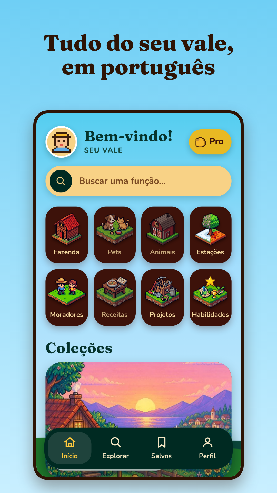
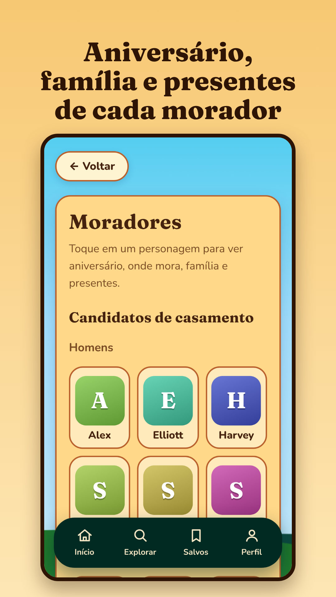
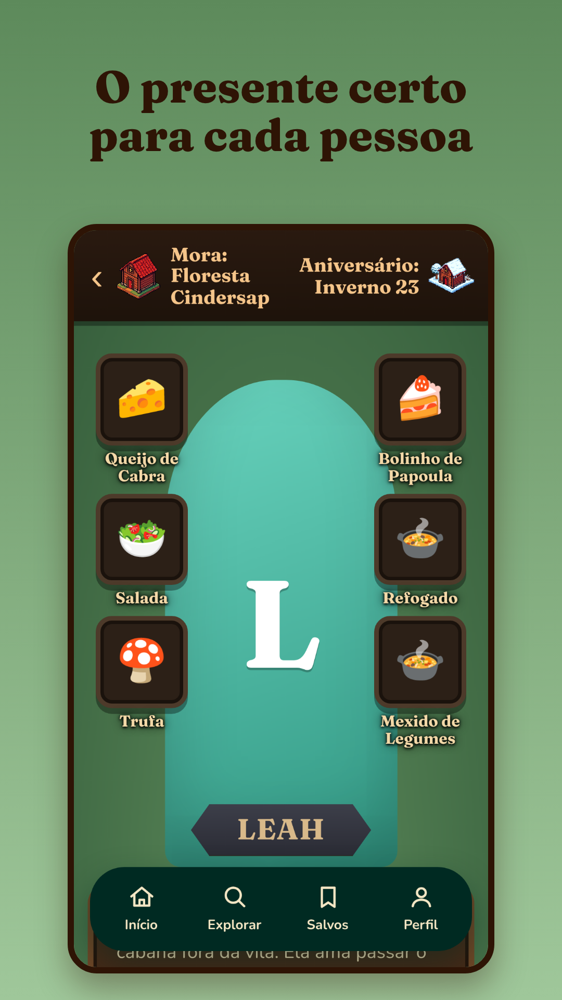
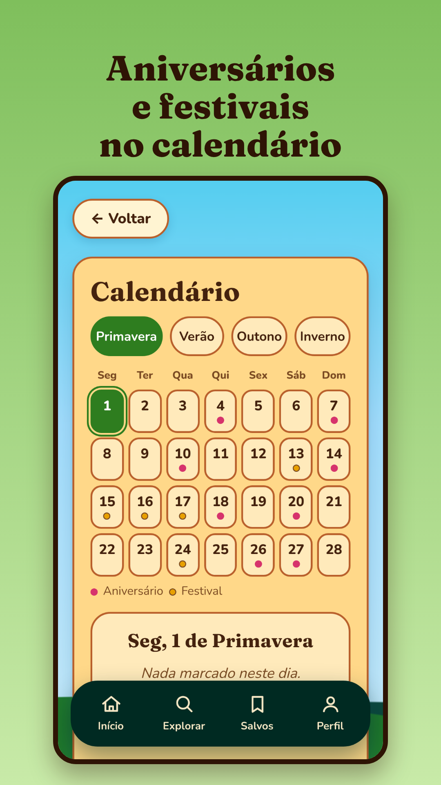

# Stardew Notes

Guia de bolso gratuito para Stardew Valley, em português, para Android. Reúne num lugar só o que o jogador
costuma procurar na wiki no meio da partida, e tem um **botão flutuante sobre o jogo** que mostra o que
importa no dia.

> App de fã, **não oficial e não endossado pela ConcernedApe**. Stardew Valley e todos os seus nomes,
> imagens e conceitos pertencem à ConcernedApe LLC. O app é gratuito, sem anúncios nem compras, e usa
> recursos do jogo com permissão da ConcernedApe, condicionada a ser 100% gratuito.

| Início | Moradores | Painel do morador | Calendário |
|---|---|---|---|
|  |  |  |  |

## Funções

| Função | O que faz |
|---|---|
| Moradores | Perfil, aniversário, família e gostos de presente de cada morador, com página de item |
| Presente certo | Escolha até 3 moradores e veja o que todos amam |
| Calendário | Aniversários e festivais de cada estação |
| Planejador de plantio | O que ainda dá tempo de colher e quanto rende por dia |
| Receitas | Os 81 pratos, ingredientes e como aprender (TV, cartas, habilidade, loja), com marcação de aprendidas |
| Habilidades | Níveis, profissões e Caverna da Maestria, com painel no estilo do jogo |
| Animais, Pets e Construções | Rendimento por animal, estratégias de lucro, amizade dos pets e custos de cada obra |
| Minhas notas | Planos, metas e lembretes, com busca, fixar e concluir |
| Salvos | Funções e moradores marcados com ⭐, num lugar só |
| Backup e restauração | Exporta tudo num arquivo .json (compartilhar no Android) e restaura com validação |
| Perfeição pelo save | Importa o arquivo do save e mostra o progresso por categoria |
| Assistente flutuante | Overlay nativo sobre o jogo: festival, Carrinho de Viagem, aniversários e o que plantar; botão "Dormi" avança o dia |

Também tem onboarding de 4 telas, atalhos personalizados, tema claro e escuro e o botão voltar do Android
integrado à navegação.

## Stack

- **App**: React 19 + TypeScript (estrito) + Vite, empacotado para Android com **Capacitor 8**
- **Nativo**: plugin Capacitor próprio em Java (`plugins/valley-native`) com serviço em primeiro plano e
  janela sobreposta (`SYSTEM_ALERT_WINDOW`) para o assistente flutuante
- **Dados**: JSON gerados a partir da Stardew Valley Wiki (CC BY-SA), guardados no app; nada vai para servidor
- **Armazenamento**: Capacitor Preferences (notas, progresso, preferências), tudo no aparelho; backup com
  Capacitor Filesystem + Share

## Qualidade e segurança

- **Testes**: 174 testes no Vitest: lógica (dados, cálculos, backup, favoritos) e **interface com React Testing
  Library** (onboarding, notas, receitas, backup e o fluxo do app do primeiro uso até os favoritos), rodando em jsdom
- **CI**: cada push gera um APK de teste no GitHub Actions e publica na aba Releases
- **Segurança antes do merge**: cada pull request passa por análise do **SonarQube Community**
  (`ci/sonarqube.sh`), que reprova vulnerabilidades e bugs graves
- **Sem segredos no repositório**: varredura de histórico com gitleaks; a chave da loja fica nos segredos do GitHub
- **Privacidade**: sem cadastro, sem rastreamento e sem internet para funcionar

## Rodando localmente

```bash
npm ci
npm run dev        # prévia no navegador (o botão flutuante só existe no Android)
npm test           # testes
npm run build      # checagem de tipos + build de produção
```

Para Android (precisa de JDK 21 e Android SDK):

```bash
npm run build
npx cap add android
npm run android:config   # aplica o ícone
npx cap sync android
cd android && ./gradlew assembleDebug
```

O jeito mais simples de testar no celular é baixar o `StardewNotes-teste.apk` na aba
[Releases](https://github.com/Rodzza/Star_Valley/releases/tag/teste).

## Estrutura

```
src/
  screens/      telas (uma por função)
  data/         dados do jogo (JSON e TS)
  utils/        regras e cálculos (com testes ao lado)
  notes/        notas do usuário
  onboarding/   estado do onboarding e atalhos
  native/       ponte com o plugin nativo (overlay, botão voltar)
plugins/valley-native/   plugin Android (Java) do assistente flutuante
ci/                      scripts de CI (SonarQube)
loja/                    ficha e imagens da Google Play
```

## Créditos

Dados do jogo: [Stardew Valley Wiki](https://stardewvalleywiki.com) e colaboradores, sob CC BY-SA. A lista de
páginas usadas está dentro do app, em Perfil › Sobre, fontes e licenças.

Feito por [Rodrigo Ferreira](https://github.com/Rodzza).
